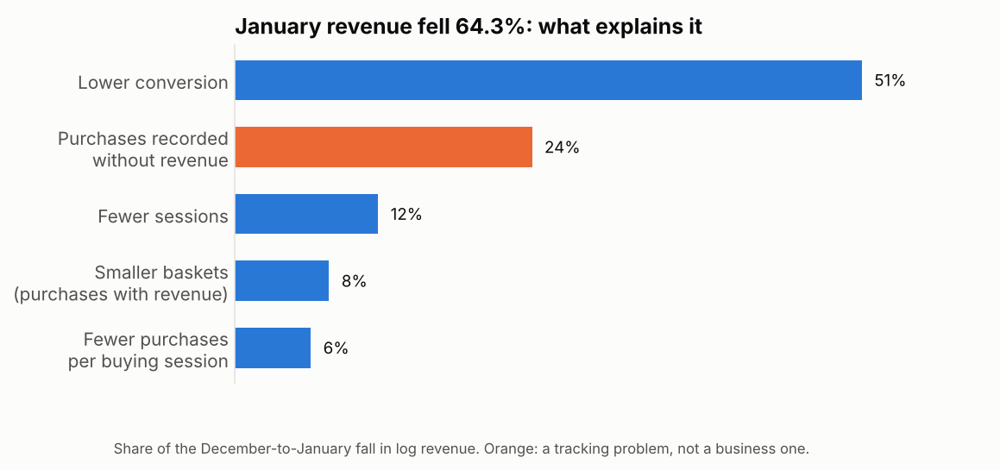
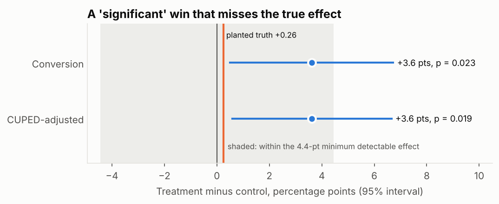

# Product Analytics in SQL: Six E-commerce Cases on BigQuery

[](https://github.com/janeruxi1/ecommerce-sql-product-analytics/actions)
[](cases/)
[](LICENSE)

Six questions a product or e-commerce team asks every quarter, each answered with one or two
BigQuery queries on public data: where shoppers drop out of checkout, how to rebuild sessions
from raw events, who comes back, what number to steer by, why revenue fell, and whether a test
won. Every query is also run on small tables with hand-computed answers on every push, so the
SQL is tested, not just written.

**Two findings worth reading first.** The January revenue drop ([case 05](cases/05_revenue_drop/))
is partly a tracking failure: a quarter of January purchases arrived without revenue, which
explains most of the apparent fall in basket size. And the A/B readout ([case 06](cases/06_ab_readout/))
returns a "significant" win that a planted ground truth, a power calculation and an A/A check all
show to be noise.

<p>
  
  
</p>

The full run on BigQuery scanned 5.44 GB in ten queries (well inside the free 1 TiB a month;
$0.03 at on-demand prices). Run record: [`results/run_record.json`](results/run_record.json).

## The cases

| # | Question | Data | SQL techniques | Result |
|---|---|---|---|---|
| [01](cases/01_checkout_funnel/) | Where do sessions drop out of checkout, and is mobile worse? | GA4 sample | `UNNEST` of nested params, ordered funnel with inequality joins, `ROLLUP` | 78.6% of sessions never view a product; mobile converts as well as desktop; 41.5% of purchasing sessions skip a tracked step |
| [02](cases/02_sessionization/) | Can sessions be rebuilt from timestamps, and how much does the threshold matter? | GA4 sample | `LAG`, running `SUM` with a `RANGE` frame, `UNNEST` of an array literal | A 30-minute rule rebuilds GA4's 360,129 sessions within 1.3%; 15 or 60 minutes moves the count by 3.5–3.7% |
| [03](cases/03_cohort_retention/) | Who orders again 1–12 months later, by acquisition channel? | theLook | first-touch cohorts, `DATE_DIFF` in months, `GENERATE_ARRAY` grid, `GROUPING SETS` | Only 1.6–1.8% of customers reorder in any later month, flat to month 12; no channel differs beyond noise |
| [04](cases/04_north_star/) | What weekly number should the team steer by, and what must not get worse? | theLook | metric tree, named `WINDOW` with trailing frames, `LAG`, maturity flag | Weekly active buyers +49% in 2025 with orders per buyer and net revenue per order flat; guardrails held |
| [05](cases/05_revenue_drop/) | Why did revenue fall in January? | GA4 sample | data-quality checks, exact log split of drivers, shift-share (volume / mix / rate), `QUALIFY` | Revenue −64.3%: a quarter of January purchases lost their revenue tag, conversion fell site-wide, segment mix explains ~0 |
| [06](cases/06_ab_readout/) | Did the checkout test win, and can the readout be trusted? | theLook | hash randomisation, z-tests and CUPED in SQL, erfc p-values, 200-split A/A with `GENERATE_ARRAY` | A "significant" +3.6-point win that is a false positive: planted truth +0.26, MDE 4.4; A/A false-positive rate 4.0% |

Each case folder has the query (`.sql`, with comments explaining every step) and a write-up:
the question, why it matters, the approach, the result, and the checks and pitfalls.

## How the SQL is tested

The queries are written once, in BigQuery SQL, with placeholders for the source tables. The same
text runs two ways:

* **on BigQuery**, against the public tables (`scripts/run_bigquery.py`, results in
  [`results/`](results/));
* **in CI**, translated to DuckDB with [sqlglot](https://github.com/tobymao/sqlglot) and run on
  small tables shaped like the real ones (GA4's nested arrays and structs included), where every
  answer was worked out by hand: a session that adds to cart before viewing a product, three
  events at the same instant, a customer whose first order was cancelled, a buyer who returned
  everything, a revenue change whose parts must add up. The A/B readout is compared with an
  independent pandas implementation to 1e-9.

Other checks: every file is a single read-only `SELECT` that parses as BigQuery SQL and reads only
the public tables; no CTE shares a name with a column (BigQuery resolves the table first, DuckDB
the column, so that mistake would pass the DuckDB tests and fail on BigQuery: the first dry run
caught exactly this); the runner dry-runs every query and stops before spending anything if one
would scan more than a set limit; and every number quoted in this README and the case write-ups is
checked against the files in `results/`.

## Data

| Source | What | Notes |
|---|---|---|
| [GA4 sample e-commerce export](https://developers.google.com/analytics/bigquery/web-ecommerce-demo-dataset) (`bigquery-public-data.ga4_obfuscated_sample_ecommerce`) | Web events from the Google Merchandise Store, 1 Nov 2020 – 31 Jan 2021, in the nested GA4 export schema | Obfuscated by Google: some values are placeholders and internal consistency is limited |
| theLook eCommerce (`bigquery-public-data.thelook_ecommerce`) | A fictional clothing store: users, orders, order items, products and web events, several years | Synthetic and regenerated by Google, so counts change between runs; the run date is in `results/run_record.json` |

Neither dataset is copied into this repository; the queries read them in place.

## Reproduce

**Tests (no Google account needed):**

```bash
pip install -r requirements.txt
pytest
```

**On BigQuery:** free in the BigQuery sandbox, no billing account. Step-by-step, including
Cloud Shell: [`docs/RUN_ON_BIGQUERY.md`](docs/RUN_ON_BIGQUERY.md).

```bash
python scripts/run_bigquery.py --project YOUR_PROJECT_ID --dry-run   # bytes each query would scan
python scripts/run_bigquery.py --project YOUR_PROJECT_ID             # run and save results/
python scripts/print_query.py 05_revenue_drop/segment_shift_share    # one query, ready to paste
```

## Repository layout

```
├── cases/
│   ├── 00_data_profile/       # row counts, date ranges, null rates: run first
│   ├── 01_checkout_funnel/    # each case: the query (.sql) and a write-up (README.md)
│   ├── 02_sessionization/
│   ├── 03_cohort_retention/
│   ├── 04_north_star/
│   ├── 05_revenue_drop/
│   └── 06_ab_readout/
├── results/                   # query outputs from BigQuery + run record (bytes, timings)
├── scripts/
│   ├── run_bigquery.py        # dry-run, cap, run, save
│   ├── print_query.py         # print a query with the real table names
│   └── make_figures.py        # draw docs/figures/ from results/
├── src/casebook/sql.py        # load queries, fill in table names, translate to DuckDB
├── tests/                     # known-answer tables for every case; query, runner and reported-number checks
└── docs/                      # RUN_ON_BIGQUERY.md, figures/
```

## Limitations

* **The GA4 sample is obfuscated and short** (three months over the holidays), so findings
  describe this sample, not the real store.
* **theLook is synthetic.** Its levels (retention, return rates) say little about real shoppers;
  the cases use it for the method and the checks.
* **The A/B test is simulated** on real theLook traffic with a planted effect, to check that the
  readout recovers a known truth. It is not evidence about a real redesign.

---
*Xi Ru · [GitHub](https://github.com/janeruxi1)*
