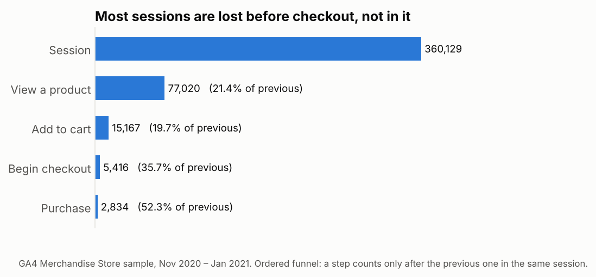

# 01 · Checkout funnel by device

**Question.** Of all sessions on the Google Merchandise Store, how many view a product, add to
cart, begin checkout and purchase, in that order? Where is the biggest drop, and does mobile
lose more shoppers than desktop?

**Why it matters.** A funnel tells a product team which step to work on. The step with the
largest absolute loss is not always the one with the worst rate, and a device gap points to a
specific fix (for example a mobile checkout form) instead of a general one.

**Data.** GA4 sample export, 1 November 2020 – 31 January 2021. One session = one
`user_pseudo_id` + `ga_session_id` pair.

## Approach

1. Pull `ga_session_id` out of the nested `event_params` array with a scalar subquery over
   `UNNEST(event_params)`.
2. Build an **ordered (closed) funnel**: each step counts only if it happens at or after the
   previous step in the same session. A chain of CTEs finds, for each session, the first
   `view_item`, then the first `add_to_cart` after it, and so on.
3. Count sessions at each step per device, with `ROLLUP` adding the all-devices row, and report
   the step rate, the rate from session start, and a standard error for comparing devices.
4. Count sessions that purchased **without** passing every tracked step: a tracking check, since
   GA4 can record a purchase whose earlier steps were not sent.

**SQL techniques:** `UNNEST` of an array of structs, `LEFT JOIN` with an inequality condition,
`GROUP BY ROLLUP`, `COUNTIF`, `SAFE_DIVIDE`, wide-to-long with `UNION ALL`.

## Result

From [`results/01_checkout_funnel/funnel.csv`](../../results/01_checkout_funnel/funnel.csv)
(360,129 sessions, November 2020 – January 2021):

| Step | Sessions reaching it | Rate from previous step |
|---|---|---|
| Session | 360,129 | |
| View a product | 77,020 | 21.4% |
| Add to cart | 15,167 | 19.7% |
| Begin checkout | 5,416 | 35.7% |
| Purchase | 2,834 | 52.3% |

* **The big losses are before checkout.** 78.6% of sessions never view a product, and 80.3% of
  the sessions that do view one never add it to cart. Once a shopper begins checkout, about half
  finish. The product-page-to-cart step is where a change would move the most sessions.
* **Mobile is not worse.** Every step rate is within 2.5 points across devices. From checkout to
  purchase, mobile converts 53.4% against desktop's 51.5%, a difference of 1.9 points with a
  standard error of 1.4 points: not distinguishable. A mobile-specific checkout project is not
  supported by this data.
* **Tracking gap.** 4,848 sessions recorded a purchase, but only 2,834 passed every tracked step in
  order: 41.5% of purchasing sessions skipped a step (for example a purchase with no
  `begin_checkout`). Before trusting step-level rates in a real store, that gap needs explaining;
  in this sample it is partly Google's obfuscation.

## Checks and pitfalls

* **Open versus closed funnel.** Counting any `add_to_cart` in a session (open funnel) overstates
  step 2 when shoppers add to cart from a list page without viewing a product. The test
  ([`tests/test_01_02_ga4_sessions.py`](../../tests/test_01_02_ga4_sessions.py)) includes a
  session that adds to cart *before* viewing a product and checks it stops at step 1.
* **Session key.** `ga_session_id` is only unique within a user; the key is the pair.
* **Obfuscated sample.** Google notes the sample's internal consistency is limited, so the
  purchase step is cross-checked against all sessions with a purchase.
