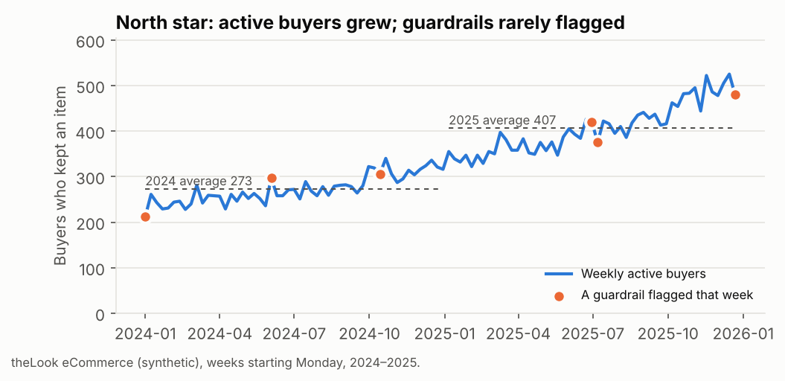

# 04 · A north-star metric with guardrails

**Question.** What single weekly number should an e-commerce team steer by, what explains its
movements, and what must not get worse while it grows?

**Why it matters.** Revenue alone can be pushed up by discounting into orders that come back or
get cancelled. A north star that only grows when customers buy *and keep* what they buy, with
guardrails watched every week, keeps growth honest.

**Data.** theLook eCommerce (synthetic), weekly (Monday-start), January 2024 – December 2025.

## The metric

* **North star: weekly active buyers**, customers who placed an order that week and kept at
  least one item (not cancelled, not returned).
* **Metric tree:** net revenue = active buyers × orders per buyer × net revenue per order. Each
  week's change can be read off the three factors.
* **Guardrails:** cancellation rate, item return rate, days from order to delivery, and the
  share of buyers who are new. A week is flagged when a guardrail is more than 3 standard
  deviations worse than its own trailing 12-week average (no verdict until there are two prior
  weeks).

**SQL techniques:** item-level rollups joined to orders, first-purchase dating over the full
history, `DATE_TRUNC(..., WEEK(MONDAY))`, `LAG` for 4-week change, a named `WINDOW` with
`ROWS BETWEEN 12 PRECEDING AND 1 PRECEDING`, and a maturity flag.

## Result

From [`results/04_north_star/north_star_weekly.csv`](../../results/04_north_star/north_star_weekly.csv)
(104 weeks):

| Weekly average | 2024 | 2025 |
|---|---|---|
| **Active buyers (north star)** | **272.9** | **406.5** |
| Orders per buyer | 1.00 | 1.00 |
| Net revenue per order | $86.01 | $85.87 |
| Net revenue | $23,499 | $34,978 |
| Cancellation rate | 15.1% | 14.9% |
| Item return rate | 11.5% | 11.7% |
| Days to deliver | 3.96 | 3.96 |
| New-buyer share | 71.4% | 65.1% |

* **All of the growth is more buyers.** Active buyers rose 49% from 2024 to 2025 while orders per
  buyer and net revenue per order stayed flat, so the metric tree puts the whole net-revenue gain
  on the top branch.
* **Guardrails held.** Cancellations, returns and delivery time are unchanged year on year. The
  falling new-buyer share is expected as the base of past buyers grows, not a warning.
* **The alert rule is too sensitive as built.** It flagged 6 of 416 guardrail-weeks (one return
  spike, one slow-delivery week, four low new-buyer weeks), several times what a true 3-sigma rule
  would give, because a standard deviation from 12 weeks is itself noisy. In production I would
  set the threshold by back-testing it to a target of about one false alarm a quarter.

## Checks and pitfalls

* **Returns arrive late.** The latest weeks look better than they will once returns come in, so
  weeks ending within 28 days of the data end are flagged `returns_immature`; the test checks the
  cutoff.
* **The tree multiplies back.** The test checks active buyers × orders per buyer × net revenue
  per order equals net revenue, week by week, and that a buyer whose whole order was returned is
  not counted as active.
* **Trailing windows exclude the current week**, so a spike cannot hide itself by raising its own
  baseline.
